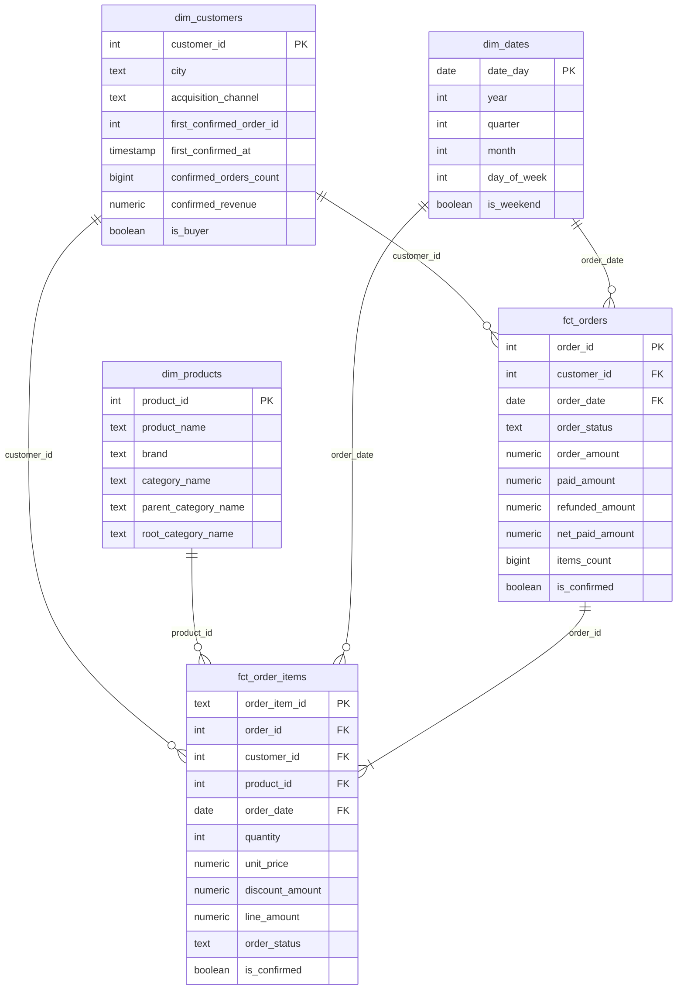
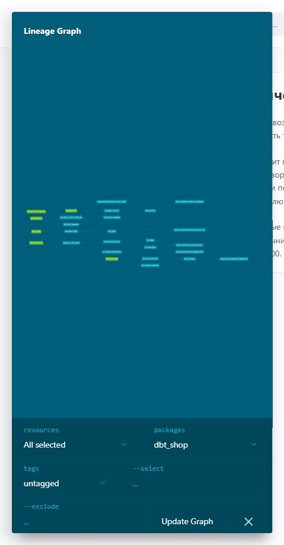

# Витрины интернет-магазина

Первый этап сквозного проекта: аналитическая модель магазина по схеме «звезда».
PostgreSQL хранит исходные данные, loader копирует шесть таблиц в `dwh.raw`
в Greenplum, dbt строит аналитические слои.

Основа проекта - [репозиторий семинара](https://github.com/RKurbanova/store_hse).
В исходной версии был только PostgreSQL. Для ДЗ добавлены Greenplum и loader;
исходный `init/01_init.sql` с данными магазина сохранён.
Используется образ [woblerr/greenplum:7.1.0](https://github.com/woblerr/docker-greenplum).

## Запуск

Нужны Git и запущенный Docker Desktop. Команды выполняются из папки проекта.

```sh
docker compose up -d
docker compose logs loader
docker compose run --rm dbt deps
docker compose run --rm dbt build
docker compose run --rm dbt docs generate
docker compose run --rm --service-ports dbt docs serve --host 0.0.0.0 --port 8080
```

После строки «Готово» в логах loader данные доступны в `dwh.raw`.
Документация: http://localhost:8080. `dbt deps` нужен перед первым запуском
и после изменения `packages.yml`.

| Система | Хост | Порт | База | Пользователь | Пароль |
| --- | --- | --- | --- | --- | --- |
| PostgreSQL | localhost | 5436 | shop | student | studentpass |
| Greenplum | localhost | 5440 | dwh | gpadmin | gpadmin |

Если порты заняты, задайте `PG_PORT`, `GP_PORT` или `DOCS_PORT` перед запуском.
Остановка с сохранением данных: `docker compose down`.
Повторная загрузка источника: `docker compose run --rm loader`.
Loader читает PostgreSQL в согласованном снимке и заменяет все таблицы `raw`
в одной транзакции, без преобразования данных.

## Модель данных



| Витрина | Зернистость | Бизнес-вопрос |
| --- | --- | --- |
| `fct_orders` | Один нетестовый заказ | Какая выручка и средний чек по городам и месяцам? |
| `fct_order_items` | Один товар в нетестовом заказе | Какая выручка по категориям и какие бренды чаще возвращают? |
| `dim_customers` | Один клиент, включая не купивших | Какая доля покупателей по каналам привлечения и когда клиент впервые купил? |
| `dim_products` | Один товар | К какому бренду, категории и корневой категории относится товар? |
| `dim_dates` | Один календарный день | Как распределены покупки по месяцам и дням недели? |

Слои:

- `analytics_staging`: по одному view на таблицу источника, без JOIN и агрегаций.
- `analytics_intermediate`: view для платежей по заказу, количества товаров,
  дерева категорий и покупок клиента.
- `analytics_marts`: пять таблиц фактов и измерений.

Модели обращаются к `source()` только в staging. Исключение вне моделей -
singular-тест независимой сверки выручки с `raw.orders` и `raw.payments`,
который по условию ДЗ читает источник напрямую.

### Правила расчёта

Подтверждённая покупка - нетестовый заказ со статусом `paid` и хотя бы одной
успешной операцией с неотрицательной суммой. Успешная отрицательная операция
считается возвратом. Определение вынесено в doc-блок `confirmed_order`.

Выручка - сумма `order_amount` подтверждённых заказов; на уровне позиций -
сумма `line_amount` при `is_confirmed = true`. Платежи сначала агрегируются
по заказу, поэтому попытки оплаты и оплата частями не размножают строки.
Повторное списание сохраняется в `paid_amount`, но не увеличивает выручку.

`line_amount = quantity * unit_price - discount_amount`; скидка задана на
всю позицию. `items_count` - число разных `product_id`, а не число единиц.
Тестовые заказы и их позиции исключены из обоих фактов.

Первая покупка определяется по времени оформления заказа `ordered_at`,
при равном времени - по меньшему `order_id`. Клиенты без покупок сохраняются:
счётчик и выручка равны 0, первая покупка - null, `is_buyer = false`.
Измерения клиентов и товаров хранят текущие атрибуты, SCD Type 1.

Категории разворачиваются рекурсивно: родитель - непосредственно над
категорией, корень - верхний уровень независимо от глубины. Путь из ID
защищает обход от повторного посещения категории. Календарь включает все
даты между минимальной и максимальной датой исходных заказов.

### Хранение в Greenplum

| Витрина | Распределение | Хранение | Причина |
| --- | --- | --- | --- |
| `fct_orders` | `distributed by (order_id)` | append-optimized, column | Ключ заказа распределяет строки и совпадает с ключом второго факта. Отчёты обычно читают лишь несколько мер. |
| `fct_order_items` | `distributed by (order_id)` | append-optimized, column | Позиции заказа находятся на том же сегменте, что и заказ. Колоночное хранение подходит для агрегаций выбранных мер. |
| `dim_customers` | `distributed replicated` | heap | Маленькое измерение доступно на каждом сегменте, JOIN не требует его пересылки. |
| `dim_products` | `distributed replicated` | heap | Маленький справочник товаров и категорий хранится на каждом сегменте. |
| `dim_dates` | `distributed replicated` | heap | Небольшой календарь используется обоими фактами и доступен локально каждому сегменту. |

В `init/greenplum/load_raw.sql` таблицы `raw.orders`, `raw.order_items` и
`raw.payments` распределены по `order_id`. Такой же ключ у обоих фактов.
При соединении фактов по `order_id` строки уже расположены совместно.
Если распределить позиции по `product_id`, для JOIN с заказами по `order_id`
потребуется Redistribute Motion или Broadcast Motion. Для JOIN по клиенту,
товару и дате используются реплицированные измерения.

Настройки заданы в `config()` каждой витрины. Макрос
`macros/greenplum_create_table_as.sql` добавляет их в CREATE TABLE.
Все витрины полностью пересоздаются при сборке.

Проверка фактического хранения:

```sql
select c.relname, pg_get_table_distributedby(c.oid) as distribution,
       am.amname as storage
from pg_class c
join pg_namespace n on n.oid = c.relnamespace
left join pg_am am on am.oid = c.relam
where n.nspname = 'analytics_marts' and c.relkind = 'r'
order by c.relname;
```

### Граф зависимостей



## Тесты

Generic-тесты проверяют уникальность и заполненность ключей staging и marts,
ссылки между фактами и измерениями, допустимые статусы. Собственный тест
`non_negative` применён к суммам и счётчикам. Отрицательные возвраты в источнике
им не проверяются: это допустимые платёжные операции.

Singular-тесты:

- сумма заказа совпадает с суммой его позиций;
- подтверждённая выручка совпадает с независимым расчётом по источнику;
- по возвращённым заказам `net_paid_amount = 0`;
- подтверждённые заказы не оплачены сверх своей суммы (`severity: warn`);
- первая покупка не раньше регистрации;
- возвраты относятся к возвращённым заказам - тест из семинара.

Ожидаемое предупреждение источника: заказ **113**, сумма заказа **200**, две
успешные оплаты по **200**, всего списано **400**, переплата **200**.
Тест `assert_confirmed_orders_not_overpaid` сохраняет эту проблему как WARN.
Данные и платежи не исправляются; выручка по заказу остаётся 200.

## Дополнительное задание

Подключён пакет `dbt_utils`, версия закреплена в `packages.yml` и
`package-lock.yml`. В `dim_dates` используется `dbt_utils.date_spine`.
Начальная граница - минимальная дата заказа, конечная - максимальная дата
плюс один день: правая граница `date_spine` не включается.
На пустом источнике календарь пустой.

## Проверка с нуля

Следующие команды удаляют только тома этого стенда и загружают учебные данные заново.

```sh
docker compose down -v
docker compose up -d
docker compose logs loader
docker compose run --rm dbt deps
docker compose run --rm dbt build
```

Проверка с нуля выполнена на Greenplum 7.1.0 и dbt 1.10.13:
`PASS=125 WARN=1 ERROR=0 SKIP=0 TOTAL=126` (15 моделей и 111 тестов).
Единственное предупреждение относится к заказу 113.
Все контрольные результаты совпали с заданием:

| Проверка | Значение |
| --- | --- |
| `fct_orders` | 135 строк |
| Подтверждённые заказы | 106; сумма 91 620,00 |
| `fct_order_items` | 425 строк |
| Сумма подтверждённых позиций | 91 620,00 |
| `dim_customers` | 40 клиентов: 29 покупателей, 11 без покупок |
| Клиент 1 | Первый заказ 101; 9 покупок; 7 280,00 |
| Клиент 40 | Не покупатель; первая покупка null |
| `dim_products` | 13 товаров |
| Товар 11, Pot A | Home > Kitchen > Cookware |
| Товар 12, Case B | Electronics > Accessories > Cases |
| Выручка Electronics | 59 994,28 |
| Выручка Home | 31 625,72 |
| `dim_dates` | 133 дня, 2026-03-01 - 2026-07-11 |

`target/`, `logs/`, `dbt_packages/` и локальное окружение `.venv/`
исключены из Git. Для сдачи нужен личный репозиторий с доступом преподавателю.
Исходный remote репозитория семинара переименован в `course`;
личный репозиторий добавляется как `origin`.
